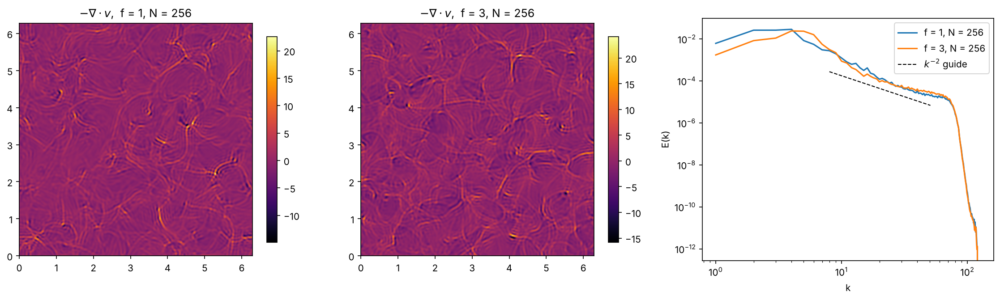
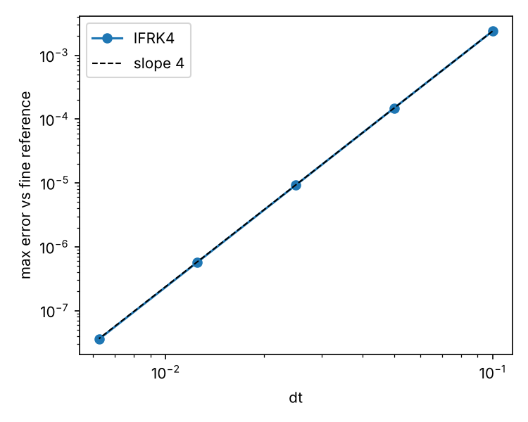
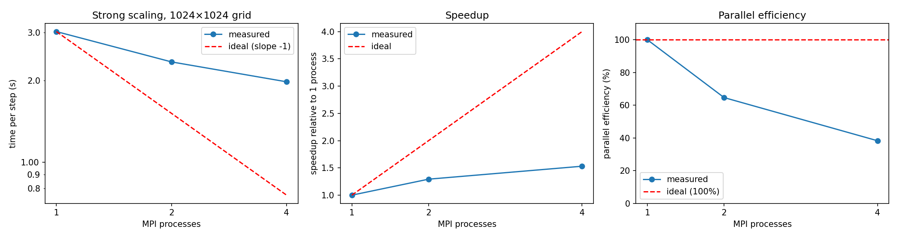

# Fourier Spectral Solver (FSS)
 
An MPI-parallel pseudo-spectral solver for the 2D rotating shallow-water equations on a doubly periodic domain, written in Python with NumPy and `mpi4py`. The solver uses a slab decomposition with `Alltoall` transposes for the 2D FFTs, and a test suite checks it against exact solutions and convergence rates.
 

 
*Decaying wave + vortical flow at N = 256 (t = 5). Left and centre: negative divergence for f = 1 and f = 3; thin bright lines are shock-like fronts. Right: shell-summed spectra. The dashed line is a k⁻² guide only; at this resolution and hyperviscosity the spectrum is not a clean power law.*
 
## Equations
 
The solver integrates the nondimensional 2D rotating shallow-water equations:
 
$$\frac{\partial \mathbf{v}}{\partial t} + f\,\hat{\mathbf{z}}\times\mathbf{v} + \nabla h + \epsilon\,(\mathbf{v}\cdot\nabla)\mathbf{v} = 0$$
 
$$\frac{\partial h}{\partial t} + \nabla\cdot\mathbf{v} + \epsilon\,\nabla\cdot(h\mathbf{v}) = 0$$
 
Here **v** = (u, v) is the horizontal velocity, h is the fluctuation of the fluid height about its mean, f is the constant rotation rate (Coriolis parameter), and ε is a dimensionless parameter that sets the strength of the nonlinear terms. In components, as implemented in `src/fss/model.py`:
 
```
u_t =  f v - h_x - ε (u u_x + v u_y)
v_t = -f u - h_y - ε (u v_x + v v_y)
h_t = -(u_x + v_y) - ε [(h u)_x + (h v)_y]
```
 
### Background
 
The shallow-water equations describe a thin layer of fluid whose depth is much smaller than the horizontal scale of the motion. They are a standard simplified model of the large-scale ocean and atmosphere. The fluid is assumed to be in hydrostatic balance, so the horizontal velocity does not vary with depth, and the flow is described by only three fields: u, v and the layer height h.
 
The terms in the equations are:
 
- **f ẑ × v (Coriolis force):** the deflection caused by the rotation of the frame. It turns moving fluid sideways and does no work.
- **∇h (pressure gradient):** a sloping free surface accelerates the fluid. In these units the gravity-wave speed is 1.
- **ε (v·∇)v (advection):** the velocity field carries itself along. This term makes the problem nonlinear.
- **∇·v + ε ∇·(hv) = ∇·[(1 + εh) v] (mass conservation):** the local depth is 1 + εh, and the height changes where the flow converges or diverges.
The model has a conserved energy, ½⟨(1 + εh)|**v**|² + h²⟩, and conserves the mean of h. These quantities are tested in `tests/test_solver.py`.
 
**Linear limit (ε = 0).** The equations support inertia–gravity waves, which oscillate with the frequency ω² = f² + |**k**|² for wavenumber **k**. They also support steady geostrophic flows (ω = 0), in which the Coriolis force balances the pressure gradient, f ẑ × **v** = −∇h. The wave solution is exact, so it is used to validate the solver (for h = A cos x and **v** = 0 initially, h(0, t) = A (f² + cos ωt) / ω² with ω² = f² + 1).
 
**Nonlinear regime (ε > 0).** Balanced vortical flow and waves interact. Waves steepen into thin shock-like fronts (hydraulic jumps). These are the bright lines in the divergence maps of the figure above, because the divergence ∇·**v** is large where the flow converges sharply. The initial condition used here is a random large-scale flow with h = 0, which is not in geostrophic balance, so it adjusts by radiating waves and gives a mixed wave–vortical state.
 
Spectral methods suit this problem because smooth parts of the flow are represented with very high accuracy. The shocks produce Gibbs oscillations, which is why a small hyperviscosity is added (see the next section).
 
For a derivation and discussion of the shallow-water equations, see G. K. Vallis, *Atmospheric and Oceanic Fluid Dynamics* (Cambridge University Press, 2017).
 
## What the solver does
 
**1. Represent each field as a sum of waves.** On the periodic domain [0, 2π)², any smooth field can be written as a sum of sines and cosines,
 
$$h(x,y,t) = \sum_{\mathbf{k}} \hat h_{\mathbf{k}}(t)\, e^{i(k_x x + k_y y)}$$
 
The solver stores the coefficients ĥₖ (the "spectral" representation) and the values on an n × n grid of points (the "physical" representation). The fast Fourier transform (FFT) converts between the two in O(n² log n) operations.
 
**2. Differentiate exactly in Fourier space.** Differentiating a wave just multiplies its coefficient: ∂/∂x → i kₓ. A derivative is therefore one FFT, one multiplication and one inverse FFT. For smooth fields the error falls faster than any power of 1/n (spectral accuracy), which is far better than finite differences at the same resolution.
 
**3. Handle the nonlinear terms in physical space.** Products such as u ∂u/∂x are expensive and awkward in Fourier space (they become convolutions over all pairs of waves). The solver transforms to the grid, multiplies point by point, and transforms back. This is the *pseudo-spectral* approach.
 
**4. Remove aliasing.** A product of two waves creates a wave of shorter wavelength than the grid can represent, and the grid then misreads it as a long wave (aliasing). This feeds spurious energy into the resolved modes. The 2/3 rule discards the top third of the wavenumbers after every product, so that no aliased wave lands in the modes that are kept.
 
**5. Step forward in time.** Steps 1–4 give the right-hand side dq/dt of the whole state q = (u, v, h). A fourth-order Runge–Kutta method advances q by Δt using four such evaluations. Small scales are damped by a hyperviscosity, which acts as a sharp filter: it removes energy near the grid scale, where the shocks pile up, and barely touches the large scales.
 
One time step is therefore: transform → multiply by i k → inverse transform → form products on the grid → transform back → dealias → combine, four times (once per Runge–Kutta stage).
 
**What this costs, and why it is parallelised.** Almost all the time is spent in 2D FFTs. A 2D FFT is a 1D FFT along every row followed by a 1D FFT along every column. With the grid split into slabs across processes, each process holds complete lines in one direction and can transform along them without talking to anyone, but the transforms in the other direction need data from every slab. Each 2D transform therefore includes one all-to-all exchange (see Parallelisation below). This is why scaling is limited by communication and memory bandwidth rather than by arithmetic alone.


## Numerical method

- **Space:** Fourier pseudo-spectral derivatives. Products are formed in physical space and dealiased with the 2/3 rule.
- **Time:** integrating-factor RK4 (IFRK4). The hyperviscous term ν(−∇²)ʳ is diagonal in Fourier space and is applied exactly through exp(−ν k²ʳ Δt), so the scheme stays fourth-order in time.
- **Hyperviscosity:** ν is set from a damping rate at the dealiasing cutoff, ν = `damp` / k_cut^(2r), so it scales with resolution.
- **State layout:** the three fields (u, v, h) are stored in one array of shape `(3, n, n)`, and all transforms are batched over the first axis.

## Parallelisation

The domain is split into slabs, one per MPI process (p processes, n/p rows or columns each):

```
physical space  (..., n/p, n)   each process owns a block of x-rows
spectral space  (..., n, n/p)   each process owns a block of ky-columns
```

A forward 2D FFT is carried out in three steps: an FFT along y (y is complete on every process), an `Alltoall` exchange that transposes the data so that x becomes complete, and an FFT along x. The inverse transform performs the same steps in reverse. These two transposes are the only communication in a time step. Derivatives, nonlinear products and the time integration act on local data, and global quantities such as the energy are computed with an `Allreduce`.

All MPI calls are contained in the grid class (`src/fss/pgrid.py`). The model, the time stepper and the diagnostics only call methods of the grid (`to_spec`, `to_phys`, `ddx`, `ddy`, `mean`, ...) and contain no MPI code.

Constraints:
- n must be divisible by the number of processes, and the number of processes can be at most n.
- Complex FFTs are used on the full wavenumber plane rather than `rfft2`, because the half-plane of `rfft2` (n/2 + 1 columns) does not divide evenly among processes.

## Validation

| Check | Result |
|---|---|
| Linear wave (ε = 0, h = A cos x) against the exact solution | agrees to ~1e-8 or better |
| Temporal convergence (nonlinear, smooth flow) | observed order 4.0 (see `results/temporal_convergence.png`) |
| Spatial convergence (smooth flow, against a fine-grid reference) | error falls geometrically with n |
| Energy ½⟨(1+εh)\|v\|² + h²⟩ and mass, inviscid | conserved to within test tolerance |
| Hyperviscosity | only removes energy |
| Parallel transform round trip | recovers the input to rounding error |



## Installation

Requirements: Python 3.9 or newer, an MPI library (MPICH or Open MPI), and `mpi4py`.

1. Install an MPI library:

   ```bash
   # Linux (Debian/Ubuntu)
   sudo apt install mpich libmpich-dev

   # macOS
   brew install mpich

   # Windows: use WSL2 and follow the Linux instructions
   ```

2. Download the code and create a Python virtual environment :

   ```bash
   git clone https://github.com/rahul-r49/FSS.git
   cd FSS
   python3 -m venv .venv
   source .venv/bin/activate          # Windows (PowerShell): .venv\Scripts\activate
   ```

3. Install the package and its dependencies (numpy, matplotlib, mpi4py, pytest):

   ```bash
   pip install -e ".[dev]"
   ```

With conda, `conda install -c conda-forge mpich mpi4py` can replace steps 1 and the `mpi4py` build. Check the installation with `mpiexec -n 2 python -c "from mpi4py import MPI; print(MPI.COMM_WORLD.Get_rank())"`, which should print `0` and `1`.


## Usage

Run the tests (13 tests):

```bash
pytest
```

Run a simulation:

```bash
mpiexec -n <processes> python scripts/run_case.py --f <f> --n <n> --T <T> --out data/<run name>
```

| Argument | Meaning |
|---|---|
| `-n <processes>` (`mpiexec`) | number of MPI processes |
| `--f` | rotation rate |
| `--n` | grid points per side |
| `--T` | final time |
| `--out` | output folder |

Two rules apply:
- The grid size `--n` must be divisible by the number of processes.
- The number of processes should not exceed the number of physical cores of the machine (see [Checking the number of cores](#checking-the-number-of-cores)). More processes than cores makes the run slower, and Open MPI refuses to start unless `--oversubscribe` is added.

The script prints the energy ratio E/E0 as the run proceeds and saves the final fields and spectrum to `data/<run name>/final.npz`. The figure at the top of this README was made from two runs (f = 1 and f = 3, both with n = 256 and T = 5).

Make a figure from the saved run :

```bash
python scripts/make_figures.py data/<run name> 
```


### Checking the number of cores

```bash
# Linux / WSL: physical cores (nproc prints logical cores)
lscpu -p=CORE,SOCKET | grep -v '^#' | sort -u | wc -l

# macOS
sysctl -n hw.physicalcpu

# Windows (PowerShell)
(Get-CimInstance Win32_Processor | Measure-Object -Property NumberOfCores -Sum).Sum
```

## Strong scaling

Strong scaling keeps the problem size fixed and increases the number of processes, to show how much faster the same problem runs. Use process counts up to the number of **physical** cores of the machine (see [Checking the number of cores](#checking-the-number-of-cores)), and a grid size divisible by all of them. Run it from the repository folder:

```bash
bash scripts/run_scaling.sh 1024 "1 2 4 8"
```

The first argument is the grid size and the second is the list of process counts. On Windows run it in WSL2, since it is a bash script.

For each process count, the script runs `scripts/benchmark.py`, which times the time-stepping loop. The plot shows:

- time per step against the number of processes, with the ideal 1/p line,
- speedup, T(1) / T(p), and parallel efficiency, speedup / p.




*Strong scaling on Intel Core i5-8350U, 4 cores / 8 threads, 1024 x 1024 grid.*


## Repository layout

```
src/fss/
  pgrid.py         MPI slab-decomposed grid (Alltoall transposes, Allreduce, gather)
  grid.py          single-process grid, used by the convergence study and the tests
  model.py         shallow-water tendency, energy and mass
  timestepping.py  IFRK4 integrator
  initial.py       initial conditions (the same state for any number of processes)
  diagnostics.py   energy spectrum, divergence
tests/             pytest suite (exact solution, convergence, conservation, parallel grid)
scripts/           run_case.py, make_figures.py, benchmark.py, run_scaling.sh, plot_scaling.py
results/           figures used in this README
```


The general approach (pseudo-spectral derivatives, 2/3 dealiasing, RK4 with hyperviscosity, slab-decomposed parallel FFT with `Alltoall`) is standard. 
This implementation was written for a course exercise on the 2D rotating shallow-water model.
